

  
   
  
    
  
  
  

 

  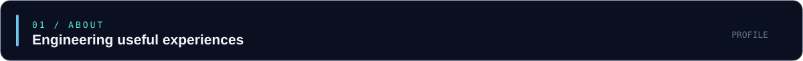
  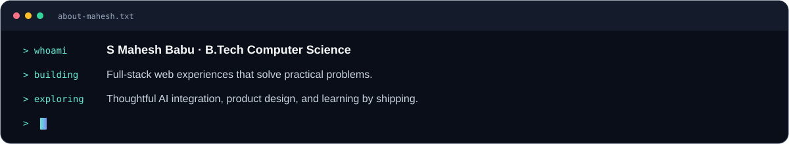

 

  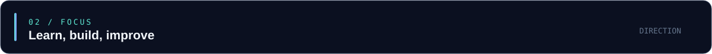
  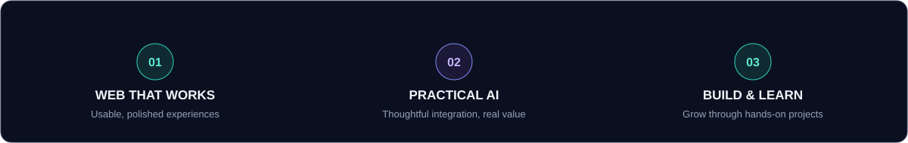

 

  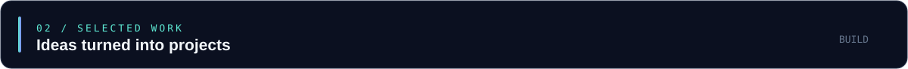

<a href="https://github.com/Mahesh88971/clinic-queue-and-patient-flow-management">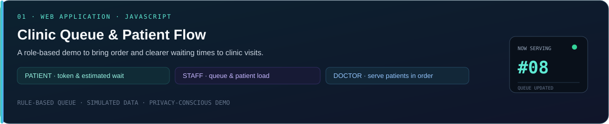</a>

<a href="https://github.com/Mahesh88971/Portfolio">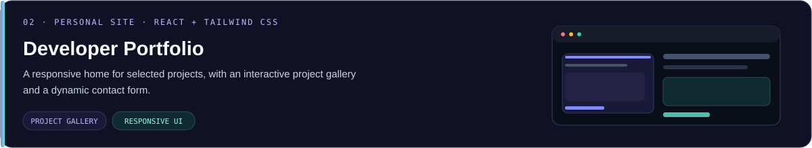</a>

<a href="https://github.com/Mahesh88971/MedGuard-AI"></a>

<a href="https://github.com/Mahesh88971/idea-connect">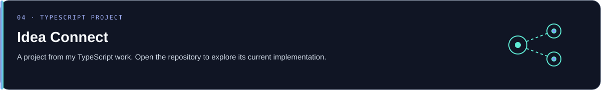</a>

  
  

 

  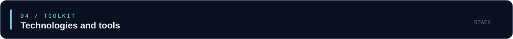
  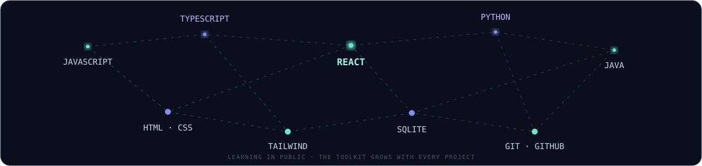

 

  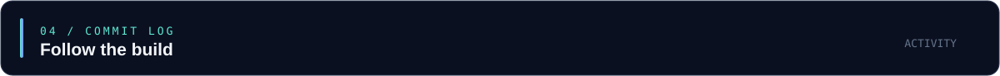
  
   
  
   
  

 

  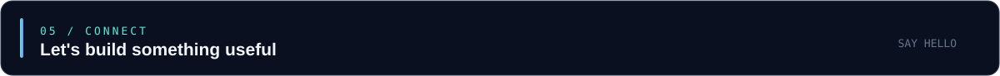
   
  
  
    
  

