<a href="https://mahesh88971.github.io/Portfolio/"></a>

  
  
  




<a href="https://github.com/Mahesh88971/clinic-queue-and-patient-flow-management"></a>

 

<a href="https://github.com/Mahesh88971/Portfolio"></a>

 

<a href="https://github.com/Mahesh88971/MedGuard-AI"></a>

<a href="https://github.com/Mahesh88971/idea-connect"></a>




  
  
  

